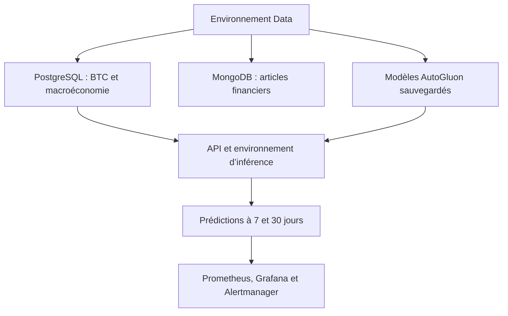

# VolatiChainXplorerAI

<p align="center">
  
</p>

<div align="center">
  <strong>Plateforme de données, de prédiction et de monitoring de la volatilité du Bitcoin</strong>
</div>

## Présentation du projet

VolatiChainXplorerAI est une application d’intelligence artificielle conçue pour prédire la volatilité du Bitcoin à des horizons de 7 et 30 jours.

Le projet met en œuvre une chaîne technique complète allant de la collecte des données jusqu’à la supervision des prédictions. Il combine les données historiques du Bitcoin avec plusieurs indicateurs macroéconomiques — taux MRO, inflation, chômage et masse monétaire M3 — afin de construire les variables utilisées par les modèles de machine learning.

Les modèles de prédiction ont été sélectionnés à l’issue d’un benchmark de plusieurs solutions AutoML. AutoGluon Tabular et ses modèles `WeightedEnsemble_L2` ont été retenus pour les deux horizons étudiés.

Les prédictions sont accessibles au moyen d’une API FastAPI sécurisée par authentification JWT. L’API peut préparer automatiquement les 15 variables attendues par les modèles à partir des dernières données disponibles dans PostgreSQL.

La chaîne de prédiction est supervisée avec Prometheus, Grafana et Alertmanager. Elle permet notamment de surveiller les requêtes, les erreurs, la durée des prédictions, les valeurs produites et l’ancienneté des données utilisées. Une notification Discord est envoyée lorsqu’une anomalie liée à la fraîcheur des données est détectée.

Le projet est développé dans le cadre d’une certification professionnelle en développement de solutions d’intelligence artificielle. Les prédictions produites sont expérimentales et ne constituent pas des conseils financiers.

## Objectifs du projet

VolatiChainXplorerAI poursuit les objectifs suivants :

1. collecter et centraliser les données historiques du Bitcoin ;
2. intégrer des indicateurs macroéconomiques susceptibles d’influencer le marché ;
3. préparer un jeu de données exploitable pour l’apprentissage automatique ;
4. construire les variables nécessaires à la prédiction de volatilité ;
5. comparer plusieurs solutions AutoML selon un protocole commun ;
6. sélectionner et sauvegarder les modèles les plus adaptés ;
7. exposer les prédictions à 7 et 30 jours au moyen d’une API sécurisée ;
8. préparer automatiquement les données nécessaires à chaque prédiction ;
9. tester les routes, les services et la préparation des variables ;
10. surveiller le fonctionnement de la chaîne de prédiction ;
11. déclencher une alerte lorsque les données utilisées deviennent trop anciennes ;
12. préparer l’intégration future de l’API dans une interface utilisateur.

## Périmètre fonctionnel

Le projet couvre actuellement quatre domaines principaux.

### Données

- collecte des prix historiques du Bitcoin ;
- collecte des indicateurs macroéconomiques ;
- collecte et stockage d’articles financiers ;
- nettoyage, rapprochement et stockage des données ;
- construction du jeu de données d’apprentissage.

### Intelligence artificielle

- feature engineering temporel ;
- création de 15 variables explicatives ;
- prédiction de la volatilité à 7 et 30 jours ;
- benchmark de plusieurs solutions AutoML ;
- sauvegarde et rechargement des modèles AutoGluon sans réentraînement.

### API

- authentification des utilisateurs par JWT ;
- récupération des données stockées ;
- préparation automatique des variables ;
- prédictions manuelles et automatiques ;
- validation des horizons autorisés ;
- gestion contrôlée des erreurs.

### Monitoring

- exposition des métriques au format Prometheus ;
- visualisation dans Grafana ;
- surveillance de la durée et du résultat des prédictions ;
- mesure de l’ancienneté des données ;
- gestion des alertes avec Alertmanager ;
- notification des alertes dans Discord.

## Vision du projet

Le projet combine trois dimensions principales :

1. collecte et préparation de données financières et macroéconomiques ;
2. stockage structuré dans PostgreSQL et MongoDB ;
3. exploitation des données au moyen d’une API FastAPI et de modèles de prédiction de volatilité.

L’objectif est de construire une plateforme technique lisible, modulaire et extensible, adaptée à la recherche, au benchmarking et à la démonstration de solutions d’intelligence artificielle appliquées à la finance.

## État du projet

Le projet est actuellement à un stade fonctionnel avancé.

Les éléments suivants sont opérationnels :

- ✅ collecte de données multisources : Bitcoin, macroéconomie et articles financiers ;
- ✅ stockage des prix du Bitcoin et des indicateurs macroéconomiques dans PostgreSQL ;
- ✅ stockage configurable des contenus financiers dans MongoDB ;
- ✅ API FastAPI modulaire et documentée ;
- ✅ authentification sécurisée par jeton JWT ;
- ✅ préparation automatique des variables nécessaires aux modèles ;
- ✅ prédictions de volatilité du Bitcoin à 7 et 30 jours ;
- ✅ intégration des modèles AutoGluon retenus pendant le benchmark ;
- ✅ métriques de prédiction exposées à Prometheus ;
- ✅ tableaux de bord provisionnés dans Grafana ;
- ✅ alertes gérées par Alertmanager et transmises vers Discord ;
- ✅ scripts de collecte, nettoyage, injection et mise à jour des données ;
- ✅ tests automatisés des routes, des services de prédiction et du monitoring ;
- ✅ documentation technique et benchmark AutoML dans le dossier `docs/` ;
- ⚠️ interface front-end non finalisée : le dépôt contient actuellement les ressources visuelles et les éléments de branding.

## Stack technique

- Python 3.12.9
- FastAPI pour l’API REST
- Pydantic pour la validation des données
- SQLAlchemy pour l’accès aux données PostgreSQL
- PostgreSQL pour les données structurées et historiques
- MongoDB pour les articles et les contenus financiers
- Alembic pour les migrations de schéma
- Pandas et NumPy pour la préparation des données
- AutoGluon Tabular pour les modèles de prédiction
- Pytest et pytest-cov pour les tests automatisés
- Docker et Docker Compose pour l’infrastructure locale
- Prometheus pour la collecte des métriques
- Grafana pour la restitution des métriques
- Alertmanager pour la gestion et l’envoi des alertes

## Fonctionnalités principales

### 1. Collecte et ingestion des données

Le projet collecte des données depuis plusieurs sources, notamment :

- CoinGecko, CoinMarketCap et yFinance pour les prix historiques du Bitcoin ;
- les sources de la Banque centrale européenne pour les indicateurs macroéconomiques ;
- les taux MRO ;
- l’inflation ;
- le chômage ;
- la masse monétaire M3 ;
- les articles financiers et contenus de presse spécialisés.

Des scripts assurent ensuite :

- le nettoyage des données ;
- leur transformation ;
- leur injection dans PostgreSQL ou MongoDB ;
- leur mise à jour.

### 2. Stockage des données

Le projet utilise deux systèmes de stockage complémentaires :

- PostgreSQL pour les données structurées, temporelles et numériques ;
- MongoDB pour les articles et contenus financiers semi-structurés.

Les principaux modèles PostgreSQL sont notamment définis dans :

- `database/postgres/models/bitcoin_prices.py`
- `database/postgres/models/macro_indicators.py`
- `database/postgres/models/users.py`

Des tables et des vues PostgreSQL permettent également de rapprocher les prix du Bitcoin et les indicateurs macroéconomiques.

### 3. API REST

L’application FastAPI est définie dans `api/main.py`.

Elle permet notamment de :

- consulter les prix historiques du Bitcoin ;
- consulter les indicateurs macroéconomiques ;
- lire les articles financiers stockés dans MongoDB ;
- obtenir des données croisées BTC, macroéconomie et articles ;
- créer et authentifier les utilisateurs ;
- protéger les routes avec une authentification JWT ;
- supprimer un compte utilisateur ;
- effectuer des prédictions de volatilité à 7 et 30 jours ;
- exposer les métriques de prédiction à Prometheus.

### 4. Prédiction de volatilité

Le backend intègre deux modèles AutoGluon correspondant aux horizons suivants :

- 7 jours ;
- 30 jours.

Les modèles retenus pendant le benchmark sont des modèles `WeightedEnsemble_L2`.

Pour réaliser une prédiction automatique, le service :

1. recherche la dernière date disponible dans PostgreSQL ;
2. récupère l’historique Bitcoin et macroéconomique nécessaire ;
3. prépare les données ;
4. calcule les variables de feature engineering ;
5. sélectionne les 15 variables attendues par le modèle ;
6. charge le modèle correspondant à l’horizon demandé ;
7. retourne la volatilité prédite et la date des données utilisées.

Les routes de prédiction sont protégées par l’authentification JWT.

### 5. Monitoring et observabilité

Le projet intègre une chaîne de monitoring composée de :

- Prometheus pour la collecte des métriques ;
- Grafana pour leur visualisation ;
- Alertmanager pour la gestion des alertes ;
- Discord pour recevoir les notifications externes.

L’endpoint suivant expose les métriques :

```text
GET /metrics
```

Les métriques métier permettent notamment de surveiller :

- le nombre de prédictions réussies ou échouées ;
- la durée des prédictions ;
- les valeurs de volatilité prédites ;
- l’ancienneté des données utilisées par le modèle.

Une règle Prometheus déclenche une alerte lorsque les données utilisées pour la prédiction ont plus de sept jours.

Les notifications Discord permettent de distinguer les états :

- `firing` : le problème est actif ;
- `resolved` : le problème a été résolu.

## Architecture du dépôt

```text
Projet-VolatiChainXplorerAI/
├── api/                            # API FastAPI
│   ├── auths/                      # Authentification et autorisations
│   ├── crud/                       # Accès aux données
│   ├── monitoring/                 # Définition des métriques Prometheus
│   ├── routers/                    # Routes de l’API
│   ├── schemas/                    # Schémas Pydantic
│   ├── services/                   # Services de prédiction et de préparation
│   ├── main.py                     # Point d’entrée FastAPI
│   └── README_API.md
├── database/                       # Connexions et modèles des bases
│   ├── conn_db/
│   ├── mongo/
│   └── postgres/
├── data/                           # Données brutes, nettoyées et exportées
│   ├── raw/
│   ├── cleaned/
│   └── exports/
├── docs/                           # Documentation du projet
│   ├── benchmark/
│   ├── veille/
│   ├── preuves_by_sprint/
│   └── readme_docs.md
├── frontend/                       # Ressources visuelles et branding
│   └── images/
├── monitoring/                     # Configuration de la supervision
│   ├── alertmanager/
│   │   └── alertmanager.yml
│   ├── grafana/
│   │   ├── dashboards/
│   │   └── provisioning/
│   └── prometheus/
│       ├── rules/
│       └── prometheus.yml
├── notebooks/                      # Analyse et prototypage
├── scripts/                        # Traitements des données
│   ├── build_dataset/
│   ├── collect/
│   ├── clean/
│   ├── injection_db_mongo/
│   ├── injection_db_postgres/
│   └── update/
├── setup/                          # Configuration générale et logs
├── tests/                          # Tests Pytest
│   ├── tests_monitoring/
│   └── tests_predictions/
├── .gitignore
├── alembic.ini
├── docker-compose.yaml
├── Dockerfile
├── pytest.ini
├── requirements.txt                # Dépendances Data
├── requirements-api-inference.txt  # Dépendances API et inférence
├── README.md
└── ...
```

> Le fichier `.env` contient des variables locales et des secrets. Il est ignoré par Git et ne doit jamais être versionné.

## Organisation des environnements Python

Le projet repose sur deux environnements Python distincts mais complémentaires.

Cette séparation permet d’éviter les conflits entre les bibliothèques utilisées pour les traitements de données et les dépendances nécessaires au chargement des modèles AutoGluon.

| Environnement | Responsabilités | Fichier de dépendances |
|---|---|---|
| Environnement Data | Collecte, nettoyage, analyse, feature engineering, entraînement et notebooks | `requirements.txt` |
| Environnement API et inférence | Chargement des modèles AutoGluon, préparation automatique des variables, prédiction, tests API et métriques Prometheus | `requirements-api-inference.txt` |

### Communication entre les environnements

Les deux environnements ne sont pas fusionnés. Chaque commande ou processus doit être exécuté avec l’environnement correspondant à sa responsabilité.

Ils communiquent au moyen des données, des modèles et des ressources partagées du projet :

1. l’environnement Data collecte et transforme les données ;
2. les données Bitcoin et macroéconomiques sont stockées dans PostgreSQL ;
3. les articles financiers sont stockés dans MongoDB ;
4. l’environnement Data construit les variables d’apprentissage ;
5. les modèles AutoGluon sont entraînés puis sauvegardés ;
6. l’environnement API charge les modèles sauvegardés ;
7. l’API interroge PostgreSQL pour récupérer les dernières données disponibles ;
8. elle calcule les 15 variables attendues ;
9. elle réalise la prédiction à 7 ou 30 jours ;
10. les métriques produites sont collectées par Prometheus et visualisées dans Grafana.



### Pourquoi séparer les environnements ?

AutoGluon et PyTorch introduisent des dépendances volumineuses et des contraintes de versions particulières.

Leur isolation :

- protège l’environnement consacré aux traitements de données ;
- limite les conflits de versions ;
- facilite le diagnostic des erreurs ;
- améliore la reproductibilité de l’API d’inférence ;
- permet de conserver un environnement adapté à chaque catégorie de tâches.

Sous Windows, l’environnement d’inférence a été créé dans un chemin court :

```text
D:\venvs\volati_api
```

Ce choix permet notamment d’éviter les erreurs liées à la longueur des chemins lors de l’installation d’AutoGluon et de PyTorch.

## Démarrage rapide

### 1. Cloner le dépôt

```bash
git clone https://github.com/PatriciaTenda/Projet-VolatiChainXplorerAI.git
cd Projet-VolatiChainXplorerAI
```

### 2. Configurer les variables d’environnement

Créer localement un fichier `.env` contenant les variables nécessaires aux services.

Exemples de variables utilisées :

```dotenv
POSTGRES_USER=your_postgres_user
POSTGRES_PASSWORD=your_postgres_password
POSTGRES_DB=your_postgres_database

MONGO_USER=your_mongo_user
MONGO_PASSWORD=your_mongo_password
MONGO_DB=your_mongo_database

DISCORD_WEBHOOK_URL_volatichainxplorerai=your_discord_webhook_url
```

Ne jamais publier les véritables valeurs du fichier `.env`.

### 3. Créer l’environnement Data

#### Windows PowerShell

```powershell
python -m venv .venv
.\.venv\Scripts\Activate.ps1
python -m pip install --upgrade pip
python -m pip install -r requirements.txt
```

#### Linux ou macOS

```bash
python -m venv .venv
source .venv/bin/activate
python -m pip install --upgrade pip
python -m pip install -r requirements.txt
```

Cet environnement est utilisé pour :

- la collecte ;
- le nettoyage ;
- l’analyse exploratoire ;
- le feature engineering ;
- l’entraînement des modèles ;
- l’exécution des notebooks.

### 4. Créer l’environnement API et inférence

Sous Windows, l’utilisation d’un chemin court est recommandée :

```powershell
py -3.12 -m venv D:\venvs\volati_api
D:\venvs\volati_api\Scripts\Activate.ps1
python -m pip install --upgrade pip
python -m pip install -r requirements-api-inference.txt
python -m pip check
```

Cet environnement est utilisé pour :

- lancer FastAPI ;
- charger les modèles AutoGluon ;
- préparer automatiquement les variables ;
- réaliser les prédictions ;
- exposer les métriques ;
- exécuter les tests de prédiction et de monitoring.

> Avant d’exécuter une commande, il faut activer l’environnement correspondant à la tâche.

### 5. Démarrer l’infrastructure locale

Docker Desktop doit être lancé avant l’exécution de la commande suivante :

```bash
docker compose up -d
```

Cette commande démarre :

- PostgreSQL sur `localhost:5433` ;
- MongoDB sur `localhost:27017` ;
- Prometheus sur `http://localhost:9090` ;
- Grafana sur `http://localhost:3000` ;
- Alertmanager sur `http://localhost:9093`.

Vérifier l’état des conteneurs :

```bash
docker compose ps
```

### 6. Lancer l’API d’inférence

Activer l’environnement API sous Windows :

```powershell
D:\venvs\volati_api\Scripts\Activate.ps1
```

Puis démarrer FastAPI :

```powershell
python -m uvicorn api.main:app --reload --host 0.0.0.0 --port 8000
```

Services disponibles :

- documentation Swagger : `http://localhost:8000/docs`
- état de l’API : `http://localhost:8000/health`
- statut simple : `http://localhost:8000/status`
- métriques Prometheus : `http://localhost:8000/metrics`

## API et endpoints

### Endpoints généraux

- `GET /` : accueil de l’API
- `GET /health` : état de l’API et des bases
- `GET /status` : statut simple de l’API
- `GET /metrics` : métriques Prometheus
- `GET /docs` : documentation Swagger
- `GET /redoc` : documentation ReDoc

### Authentification et utilisateurs

- `POST /api/v1/auth/register` : création d’un compte
- `POST /api/v1/auth/login` : authentification
- `POST /api/v1/auth/logout` : déconnexion
- `GET /api/v1/auth/me` : informations de l’utilisateur connecté
- `GET /api/v1/auth/users` : liste des utilisateurs autorisés
- `DELETE /api/v1/delete-user-account/` : suppression d’un compte utilisateur

Les routes de prédiction nécessitent un jeton JWT valide.

Dans Swagger :

1. authentifier l’utilisateur ;
2. récupérer le jeton JWT ;
3. utiliser le bouton **Authorize** ;
4. appeler la route de prédiction souhaitée.

Le jeton JWT ne doit jamais être partagé ni conservé dans la documentation.

### Prix du Bitcoin

- `GET /api/v1/bitcoin-prices/` : prix historiques du Bitcoin
- `GET /api/v1/bitcoin-prices/by-date-range` : prix du Bitcoin sur une période

### Indicateurs macroéconomiques

- `GET /api/v1/macro-indicator/daily` : indicateurs macroéconomiques quotidiens
- `GET /api/v1/macro-indicator/mro` : taux MRO
- `GET /api/v1/macro-indicator/inflation` : taux d’inflation
- `GET /api/v1/macro-indicator/unemployment` : taux de chômage
- `GET /api/v1/macro-indicator/m3` : masse monétaire M3

### Articles financiers

- `GET /api/v1/articles-financiers/` : liste des articles financiers
- `GET /api/v1/articles-financiers/{article_id}` : consultation d’un article

### Données croisées

- `GET /api/v1/bitcoin-macro-indicators/` : données Bitcoin et indicateurs macroéconomiques
- `GET /api/v1/correlated-btc-rates-articlesFi/` : données croisées Bitcoin, indicateurs et articles

### Prédictions de volatilité

- `POST /api/v1/bitcoin/volatility/predictions/latest/7` : prédiction automatique à 7 jours
- `POST /api/v1/bitcoin/volatility/predictions/latest/30` : prédiction automatique à 30 jours
- `POST /api/v1/bitcoin/volatility/predictions/manual/7` : prédiction manuelle à 7 jours
- `POST /api/v1/bitcoin/volatility/predictions/manual/30` : prédiction manuelle à 30 jours

Les horizons actuellement autorisés sont uniquement :

- 7 jours ;
- 30 jours.

## Tests

Le dépôt contient une suite de tests destinée à valider les composants critiques.

### Tests de prédiction et de monitoring

Activer l’environnement API, puis exécuter :

```powershell
python -m pytest `
  .\tests\tests_predictions `
  .\tests\tests_monitoring `
  -v
```

Les tests couvrent notamment :

- la protection JWT des routes ;
- le rejet des horizons non autorisés ;
- les prédictions à 7 et 30 jours ;
- les erreurs de préparation des données ;
- le chargement et l’appel des modèles ;
- la préparation automatique des features ;
- l’endpoint `/metrics`.

La dernière validation de cette suite a produit :

```text
13 passed
```

### Couverture des tests de prédiction

```powershell
python -m pytest `
  .\tests\tests_predictions `
  --cov=api.routers.prediction_router `
  --cov=api.services.prediction_service `
  --cov=api.services.feature_preparation_service `
  --cov-report=term-missing `
  --cov-report=html
```

## Validation du monitoring

### Vérification de Docker Compose

```powershell
docker compose config --quiet
```

L’absence de message indique que la syntaxe du fichier est valide.

### Vérification de Prometheus

```powershell
docker compose exec prometheus `
  promtool check config /etc/prometheus/prometheus.yml
```

### Vérification des règles Prometheus

```powershell
docker compose exec prometheus `
  promtool check rules /etc/prometheus/rules/prediction_alerts.yml
```

### Vérification d’Alertmanager

```powershell
docker compose exec alertmanager `
  amtool check-config /etc/alertmanager/alertmanager.yml
```

### Interfaces du monitoring

- Prometheus : `http://localhost:9090`
- cibles Prometheus : `http://localhost:9090/targets`
- alertes Prometheus : `http://localhost:9090/alerts`
- Alertmanager : `http://localhost:9093`
- Grafana : `http://localhost:3000`

## Gestion des secrets

Les identifiants des bases de données et l’URL du webhook Discord sont conservés dans le fichier local `.env`.

Le fichier `.env` :

- est ignoré par Git ;
- ne doit pas être ajouté au dépôt ;
- ne doit pas apparaître dans les captures d’écran ;
- ne doit pas être transmis dans les logs ou la documentation.

L’URL du webhook Discord est communiquée uniquement au conteneur Alertmanager au moyen d’un secret Docker Compose.

Vérifications possibles :

```powershell
git status --short --ignored .env
git grep -l "discord.com/api/webhooks"
git ls-files .env
```

Le résultat attendu est :

- `.env` indiqué comme ignoré ;
- aucune URL Discord trouvée dans les fichiers versionnés ;
- `.env` absent de la liste des fichiers suivis par Git.

## Documentation complémentaire

Le projet comprend une documentation détaillée dans plusieurs dossiers :

- `docs/readme_docs.md` : vue d’ensemble de la documentation ;
- `docs/benchmark/` : benchmark AutoML et comparaisons techniques ;
- `docs/veille/` : veille technologique et synthèses ;
- `docs/preuves_by_sprint/` : preuves fonctionnelles et techniques ;
- `api/README_API.md` : documentation de l’API ;
- `notebooks/` : analyses exploratoires et expérimentations.

## Roadmap

Les prochaines évolutions prévues sont :

- mise en place de la chaîne CI/CD ;
- correction et validation de la construction de l’image Docker de l’API ;
- finalisation de l’interface Streamlit ;
- intégration du front-end avec les routes FastAPI ;
- ajout de tests de bout en bout ;
- automatisation accrue de la collecte et de la mise à jour des données ;
- enrichissement des variables utilisées par les modèles ;
- amélioration des dashboards métier Grafana ;
- renforcement de la sécurité du déploiement.

## Limites actuelles

Les modèles de prédiction fournissent une estimation expérimentale de la volatilité du Bitcoin.

Les résultats :

- dépendent de la qualité et de la fraîcheur des données disponibles ;
- ne constituent pas un conseil financier ;
- ne garantissent pas l’évolution future du marché ;
- doivent être interprétés dans le cadre académique et expérimental du projet.

## Licence et usage

Ce projet est développé dans un cadre académique et de démonstration.

Il peut servir de base à des projets plus avancés de :

- data engineering ;
- machine learning ;
- MLOps ;
- analyse du marché des cryptomonnaies ;
- recherche en finance quantitative.

## Références

- GitHub : https://github.com/PatriciaTenda/Projet-VolatiChainXplorerAI
- Documentation projet : `docs/readme_docs.md`
- Documentation API : `api/README_API.md`

---

<p align="center">
  <i>VolatiChainXplorerAI - turning market signals into actionable intelligence.</i>
</p>
